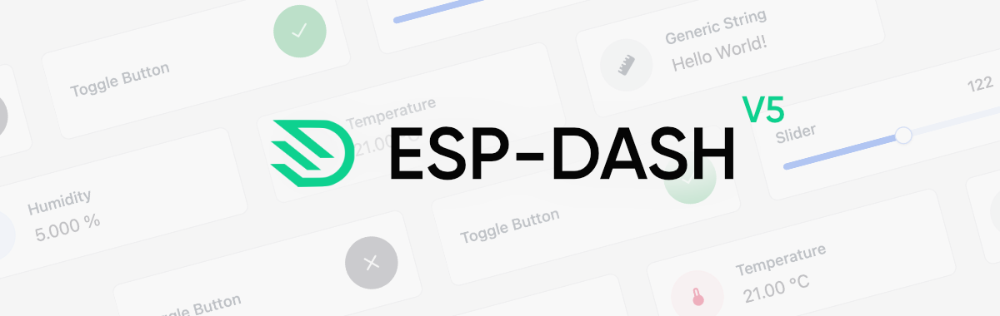
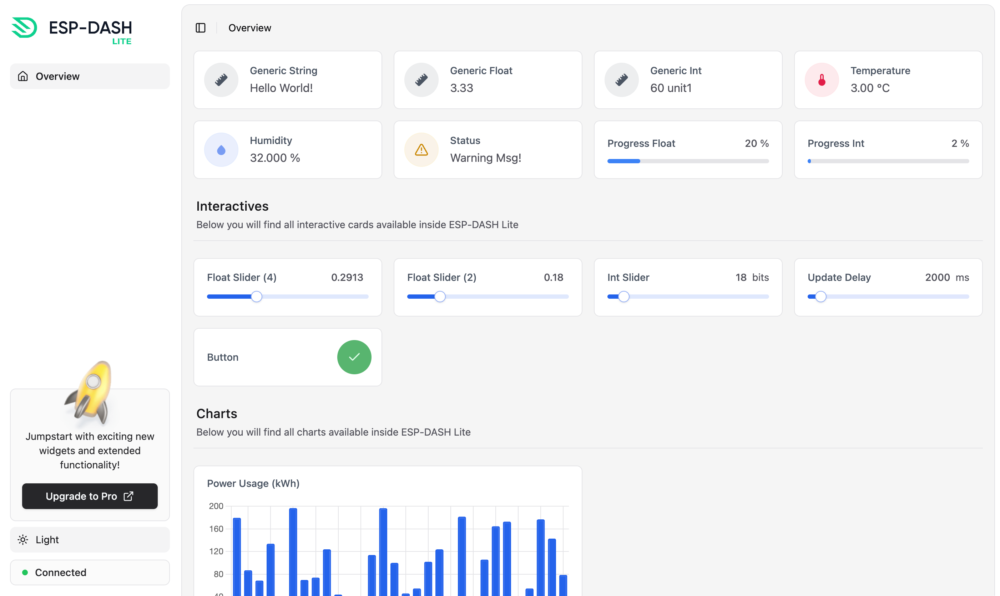
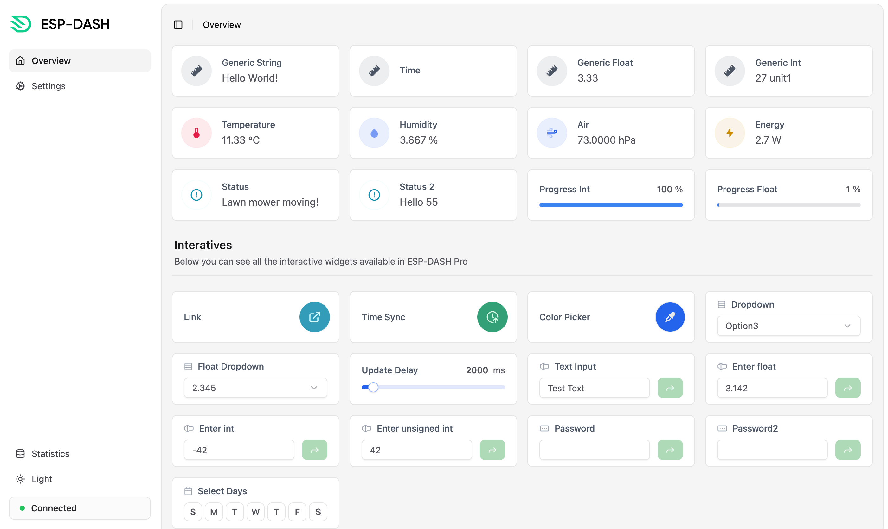
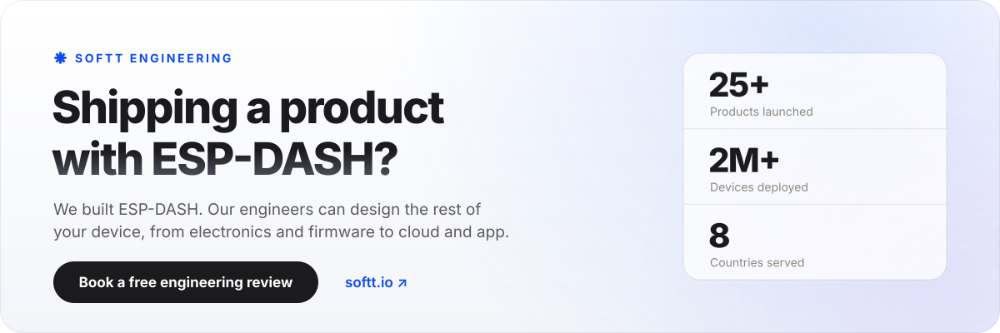

  <picture>
    <source srcset="https://raw.githubusercontent.com/ayushsharma82/ESP-DASH/master/.github/docs/splash-dark.png" media="(prefers-color-scheme: dark)">
    <source srcset="https://raw.githubusercontent.com/ayushsharma82/ESP-DASH/master/.github/docs/splash-light.png" media="(prefers-color-scheme: light)">
    
  </picture>

 

&nbsp;

&nbsp;

 

**ESP-DASH** is the 5th-gen blazing fast library to create a real-time, on-device dashboard for your devices / projects based on **ESP32**, **RP2040+W** and **RP2350+W** microcontrollers.

This library includes charts, display cards, interactive buttons and many more components to create a perfect dashboard which is accessible locally via your IoT device's IP. ESP-DASH does not require any kind of internet connection, everything is stored locally.

 

## Features

- 🔥 Automatic webpage generation.
- ⏱️ Realtime updates to all connected clients.
- 🎷 No need to learn HTML/CSS/JS. ESP-DASH provides you with a C++ interface.
- 🛫 Ready to use components for your data.
- 🏀 It's dynamic! Add or remove components anytime from the webpage.
- 📈 Inbuilt charts support.

 

## Documentation

Learn more about Installation & Usage: <a href="https://docs.espdash.pro">Click Here</a>

 

## OSS Preview

<picture>
  <source srcset="https://raw.githubusercontent.com/ayushsharma82/ESP-DASH/master/.github/docs/preview-dark.png" media="(prefers-color-scheme: dark)">
  <source srcset="https://raw.githubusercontent.com/ayushsharma82/ESP-DASH/master/.github/docs/preview-light.png" media="(prefers-color-scheme: light)">
  
</picture>

 
 
 

## Looking for more? Upgrade to Pro

ESP-DASH Pro comes with the following extended functionality:

- Jumpstart with advanced components like the input card, weekend card, joysticks, and many more premium widgets!
- Tabs Support - Organize widgets into multiple pages.
- Custom Title
- Custom Branding
- Custom Widget Size
- Enable/Disable Animations
- Atlast, It is a fantastic way to support the developer for the time went into the making & maintaining the library.

#### Available Here

- **Official Website:** [https://espdash.pro](https://espdash.pro?ref=github)

 

### Pro Preview

<a href="https://espdash.pro?ref=githubpreview" target="_blank">
  <picture>
    <source srcset="https://raw.githubusercontent.com/ayushsharma82/ESP-DASH/master/.github/docs/pro-preview-dark.png" media="(prefers-color-scheme: dark)">
    <source srcset="https://raw.githubusercontent.com/ayushsharma82/ESP-DASH/master/.github/docs/pro-preview-light.png" media="(prefers-color-scheme: light)">
    
  </picture>
</a>

 
 

## Building a product with ESP-DASH?

<a href="https://softt.io/contact?utm_source=github&utm_medium=readme&utm_campaign=esp-dash-oss" target="_blank"><picture><source media="(prefers-color-scheme: dark)" srcset="https://raw.githubusercontent.com/ayushsharma82/ESP-DASH/master/.github/softt-engineering-dark.svg"></picture></a>

ESP-DASH is built and maintained by [SOFTT](https://softt.io/?utm_source=github&utm_medium=readme&utm_campaign=esp-dash-oss), an IoT product studio. When the library is one piece of something bigger, the same engineers can design the rest of it, from the electronics and firmware to the cloud dashboard and mobile app, and take it from first brief to pilot run at a fixed price. Start with a **[free 30-minute engineering review](https://softt.io/contact?utm_source=github&utm_medium=readme&utm_campaign=esp-dash-oss)**, see **[products we've shipped](https://softt.io/portfolio?utm_source=github&utm_medium=readme&utm_campaign=esp-dash-oss)**, or write to **[hello@softt.io](mailto:hello@softt.io)**.

 
 

## Contributing

Every little or big contribution to this repository is highly appreciated! If you spot any bug or problem, please open a issue or pull request so that it can be rectified for collective good.

**For feature requests:** Please open a issue and I'll add the feature in a future release after reviewing feasibility.

 

## License

ESP-DASH Lite (OSS) is licensed under General Public License v3 (GPLv3).

If you are intending to use ESP-DASH in a commercial project, please consider purchasing [ESP-DASH Pro](https://espdash.pro) which comes with a less restrictive Softt Commercial License 1.2
